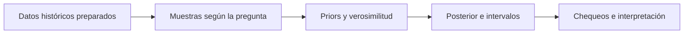

  <h1>Criminalidad e incertidumbre</h1>
  
<strong>Modelos bayesianos en R para analizar registros de Bogotá y Cali</strong> De una pregunta estadística a probabilidades posteriores, intervalos creíbles y comprobaciones del modelo.

  

    
    
    
    
  

  
<a href="#resumen">Resumen</a> · <a href="#modelos">Modelos</a> · <a href="#resultados">Resultados</a> · <a href="#evidencia">Evidencia</a> · <a href="#alcance">Alcance</a>

Proyecto académico de estadística bayesiana. La fuente integra modelos conjugados y regresión de conteos para estudiar preguntas sobre registros delictivos de **2010–2019**. Su valor está en hacer explícita la incertidumbre y revisar qué puede sostener cada resultado.

## En 30 segundos

| Aspecto | Evidencia disponible |
|---|---|
| Preguntas | Proporción de registros sin armas, composición etaria y evolución de conteos anuales |
| Modelos | Beta–Binomial, Dirichlet–Multinomial y regresión Poisson bayesiana |
| Computación | Actualizaciones conjugadas, simulación manual y ajustes con brms |
| Muestras | Bloques de 400 registros o eventos, según la pregunta |
| Entregable | Código, fórmulas e interpretación en un archivo R Markdown |
| Competencia central | Comunicar resultados probabilísticos junto con sus supuestos y límites |

**[Examinar la fuente completa](Proyecto_bayesiana_delitos.Rmd)**

Las cifras de esta página están documentadas en el texto histórico del proyecto. **No proceden de una nueva ejecución ni de una validación independiente.**

## Preguntas y modelos

| Pregunta | Enfoque | Qué permite examinar |
|---|---|---|
| ¿La proporción registrada sin empleo de armas supera el 50 %? | Beta–Binomial | Probabilidad posterior de superar un umbral |
| ¿El grupo etario adulto supera el 65 %? | Dirichlet–Multinomial | Composición por categorías y marginales Beta |
| ¿Cómo cambian los conteos anuales esperados? | Poisson con enlace log | Pendientes temporales y comparación Bogotá–Cali |

La fuente conserva **4 cadenas y 4.000 iteraciones por cadena** en los ajustes brms, con semilla 123. También incluye simulaciones y algoritmos manuales para estudiar los mecanismos de inferencia, no solo el uso de una biblioteca.

## Resultados documentados

| Análisis | Cifra histórica | Interpretación acotada |
|---|---:|---|
| Registros sin armas | P(θ > 0,5) = **11,95 %**; intervalo 95 % **[42,27 %; 51,92 %]** | La evidencia no permite afirmar una proporción mayor al 50 % con el criterio utilizado. |
| Grupo adulto | P(θ > 0,65) = **82,62 %**; intervalo 95 % **[62,83 %; 70,92 %]** | Favorece superar el umbral, pero el intervalo incluye el 65 %. |
| Tendencia de Cali | P(β > 0) ≈ **75,55 %**; razón 2019/2010 **[0,818; 1,510]** | El intervalo incluye 1: el crecimiento no es concluyente bajo el criterio del análisis. |
| Diferencia de pendientes | P(βBogotá > βCali) cercana a 1; intervalo **[0,28; 0,36]** | La pendiente estimada de Bogotá es mayor en las muestras y modelos estudiados. |

**Comprobar el ajuste también forma parte del resultado.** Los chequeos predictivos posteriores de Bogotá señalan discrepancias en los extremos. La fuente propone explorar sobredispersión o cambios de nivel, en lugar de interpretar una posterior estrecha como prueba suficiente de buen ajuste.

## Competencias demostradas

- **Formulación estadística:** traducir preguntas a parámetros, distribuciones y umbrales.
- **Inferencia bayesiana:** actualizar priors, obtener posteriores e interpretar intervalos creíbles.
- **Computación en R:** trabajar con brms, dplyr, tidyr, lubridate y ggplot2.
- **Evaluación de supuestos:** usar comprobaciones predictivas y reconocer discrepancias.
- **Comunicación técnica:** reunir código, matemáticas y conclusiones en R Markdown.

## Evidencia y navegación

| Archivo | Qué contiene |
|---|---|
| [Proyecto_bayesiana_delitos.Rmd](Proyecto_bayesiana_delitos.Rmd) | Carga de datos, modelos conjugados, simulaciones, regresiones, gráficos y discusión histórica |

Este repositorio conserva la **versión histórica centrada en R**. La [presentación complementaria del proyecto](https://github.com/fabiantovarc/analisis-bayesiano-delitos) organiza además archivos de preparación e informe; sus contenidos y cifras no deben asumirse idénticos a esta versión.

## Alcance y reproducibilidad

> Los resultados describen registros y conteos bajo modelos concretos. No son tasas por habitante, evidencia causal, pronósticos validados fuera de muestra ni una medición completa de la criminalidad de cada ciudad.

<strong>Antes de intentar reproducir el análisis</strong>

- Los CSV históricos de Bogotá y Cali **no están incluidos**. El R Markdown utiliza rutas locales que deben adaptarse.
- Se necesita R y las bibliotecas llamadas por la fuente, incluida brms; generar PDF requiere además un entorno LaTeX compatible con XeLaTeX.
- No hay archivo de versiones bloqueadas ni registro de una nueva ejecución integral.
- Las muestras de registros/fila y las muestras de eventos ponderados por CANTIDAD no son la misma unidad de análisis.
- La fuente conserva interpretaciones que deben leerse con cuidado: el intervalo [0,6283; 0,7092] **incluye 0,65**. Esta presentación no repite la afirmación histórica de que todo el intervalo lo supera.
- Las etiquetas etarias no prueban por sí solas si describen víctimas o autores. “Sin empleo de armas” es una categoría del registro; su complemento no garantiza uso confirmado de armas.

## Autor y contexto

**Edisson Fabian Tovar Castro**, según la autoría del R Markdown · [GitHub](https://github.com/fabiantovarc).

Trabajo académico. Esta presentación documental no modifica el código, los modelos ni los resultados históricos.
